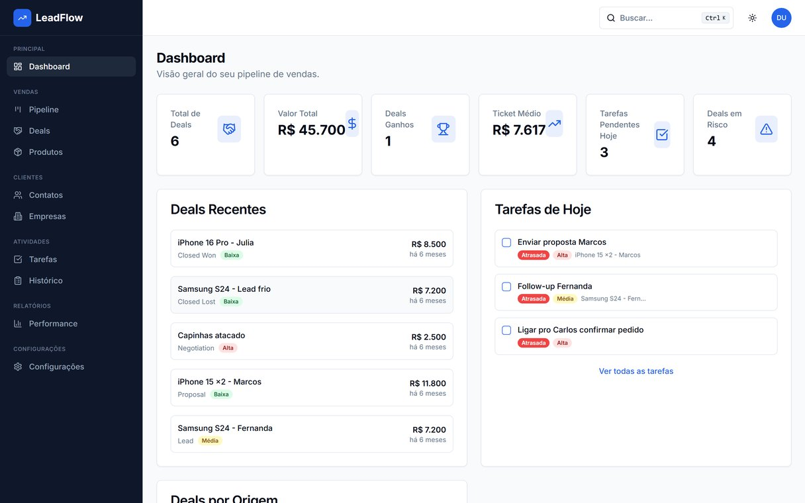

<div align="center">
  <h1>LeadFlow CRM</h1>
  <p>A lightweight CRM built for small sales teams, specifically electronics resellers who manage leads through WhatsApp and Instagram.</p>

  <p>
    
    
    
    
    
  </p>
</div>

---

## The Problem

Small businesses lose deals because follow-ups fall through the cracks. Spreadsheets don't cut it, and Salesforce is overkill. LeadFlow gives electronics resellers a visual pipeline, a full contact database, and an AI assistant that tells them where to focus their energy today.

---

## Features

### 🎯 Visual Pipeline
Drag-and-drop Kanban board across fully customizable stages. Each deal card shows value, contact, product of interest, origin channel (WhatsApp / Instagram / Referral), and a warning if the deal has gone silent for 7+ days.

### 💼 Deals
Full deal management with origin channel tracking, product of interest, priority levels, expected close date, and a complete activity history: calls, emails, meetings, notes, and tasks logged per deal.

### 👤 Contacts & 🏢 Companies
Contact database with channel preference (WhatsApp, Instagram, Phone, Email), Instagram handle, and WhatsApp number fields. Company profiles with linked contacts and open deals.

### 📱 Product Catalog
Manage your inventory: brand, category, price, and stock levels. Stock badges: 🟢 green (>5), 🟡 yellow (1 to 5), 🔴 red (out of stock). Link any product to a deal as "product of interest."

### ✅ Tasks
Task list with due dates, priority levels, and a completion toggle. Overdue and Due Today badges so nothing falls through the cracks.

### 🤖 AI Deal Analysis
Powered by **Google Gemini**. Click "Analyze" on any deal and get:
- A health **score** (0 to 100)
- A **status** label: Hot 🔥, On Track ✅, At Risk ⚠️, or Stalled 🧊
- A 2 to 3 sentence **insight** in Portuguese
- A specific **next action** recommendation

### 📈 Dashboard & Reports
- Metrics: Total Deals, Total Value, Deals Won, Average Ticket, Pending Tasks, Deals at Risk
- Today's tasks widget with inline completion
- Deals by origin channel (donut chart)
- Pipeline value by stage (bar chart)
- Conversion funnel
- Revenue over time (line chart)
- Top 5 biggest open deals

### ✨ UX Details
- Dark / light mode
- Global Spotlight search: `Ctrl+K`
- Export contacts to CSV
- Mobile responsive with collapsible sidebar
- Full PT-BR interface

---

## Tech Stack

| Layer | Technology |
|---|---|
| Framework | Next.js 14 (App Router) |
| Language | TypeScript |
| Styling | Tailwind CSS + shadcn/ui |
| Database | Supabase (PostgreSQL) |
| Auth | Supabase Auth: email/password and Google OAuth |
| Server State | TanStack Query (React Query) |
| Forms | React Hook Form + Zod |
| Drag & Drop | @dnd-kit/core + @dnd-kit/sortable |
| Charts | Recharts |
| AI | Google Gemini API |
| Deployment | Vercel |

---

## Database Schema

```
auth.users  (Supabase Auth)
    │
    ├── companies        id · user_id · name · website · industry · size
    ├── contacts         id · user_id · company_id · name · email · phone
    │                    channel · instagram_handle · whatsapp
    ├── pipeline_stages  id · user_id · name · position · color
    ├── products         id · user_id · name · brand · category · price · stock · sku · active
    ├── deals            id · user_id · contact_id · company_id · stage_id · product_id
    │                    title · value · priority · source · expected_close_date
    ├── activities       id · user_id · deal_id · contact_id · type · title · body · due_date · done
    └── tasks            id · user_id · deal_id · contact_id · title · due_date · done · priority
```

All tables use **Row Level Security (RLS)**: users can only access their own data.

A SQL trigger auto-creates 6 default pipeline stages when a new user registers.

---

## Project Structure

```
leadflow/
├── app/
│   ├── (auth)/              # Login & Register
│   ├── (dashboard)/
│   │   ├── dashboard/       # Metrics + widgets
│   │   ├── pipeline/        # Kanban board
│   │   ├── deals/           # List + [id] detail
│   │   ├── contacts/        # List + [id] detail
│   │   ├── companies/       # List + [id] detail
│   │   ├── products/        # Catalog management
│   │   ├── tasks/           # Task management
│   │   ├── activities/      # Global activity feed
│   │   ├── reports/         # Analytics
│   │   └── settings/        # Stages + preferences
│   └── api/ai/analyze/      # Gemini API route
│
├── components/
│   ├── layout/              # Sidebar · TopBar · GlobalSearch
│   ├── pipeline/            # KanbanBoard · DealCard · AddDealModal
│   ├── deals/               # DealDetail · ActivityFeed · AIDealAnalysis
│   ├── contacts/            # ContactsTable · AddContactModal
│   ├── companies/           # AddCompanyModal
│   ├── products/            # ProductsTable · AddProductModal
│   ├── tasks/               # TasksList · AddTaskModal
│   ├── dashboard/           # MetricCard · TodaysTasks · DealsBySource
│   ├── reports/             # PipelineChart · ConversionFunnel · RevenueChart
│   └── ui/                  # shadcn/ui components
│
├── lib/
│   ├── supabase/            # Browser + server clients
│   ├── hooks/               # useDeals · useContacts · usePipeline
│   │                        # useProducts · useTasks · useAIAnalysis ...
│   ├── validations/         # Zod schemas per entity
│   └── utils/               # currency (BRL) · date (pt-BR) · export (CSV)
│
└── supabase/migrations/
    ├── 001_initial_schema.sql
    └── 002_products_tasks.sql
```

---

## Getting Started

### Prerequisites
- Node.js 18+
- [Supabase](https://supabase.com) project
- [Google AI Studio](https://aistudio.google.com) API key

### Setup

```bash
git clone https://github.com/EduardoVisconti/leadflow.git
cd leadflow
npm install
```

Create `.env.local`:
```bash
NEXT_PUBLIC_SUPABASE_URL=your_supabase_project_url
NEXT_PUBLIC_SUPABASE_ANON_KEY=your_supabase_anon_key
SUPABASE_SERVICE_ROLE_KEY=your_service_role_key
GEMINI_API_KEY=your_gemini_api_key
```

Run migrations in your Supabase SQL Editor, in order:
1. `supabase/migrations/001_initial_schema.sql`
2. `supabase/migrations/002_products_tasks.sql`

```bash
npm run dev
# open http://localhost:3000
```

### Deploy to Vercel
1. Push to GitHub
2. Import repo on [Vercel](https://vercel.com)
3. Add the 4 environment variables under **Settings → Environment Variables**
4. Deploy

---

## Screenshot



To run it yourself, follow Getting Started with your own Supabase project and Gemini key.

---

## License

[MIT](LICENSE)
